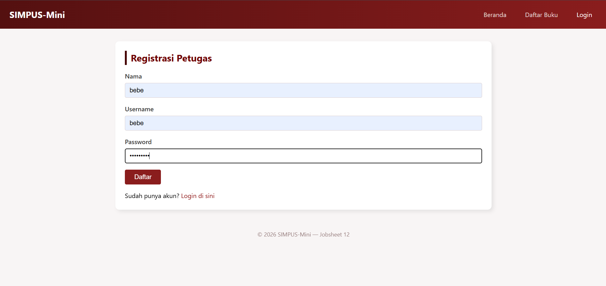
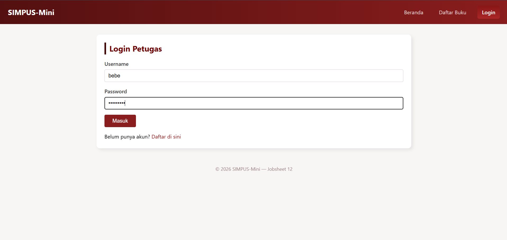
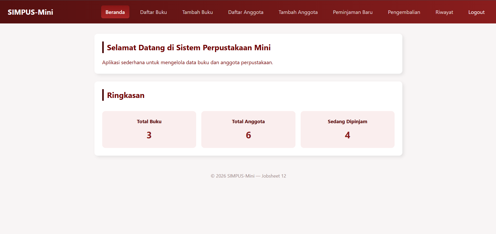
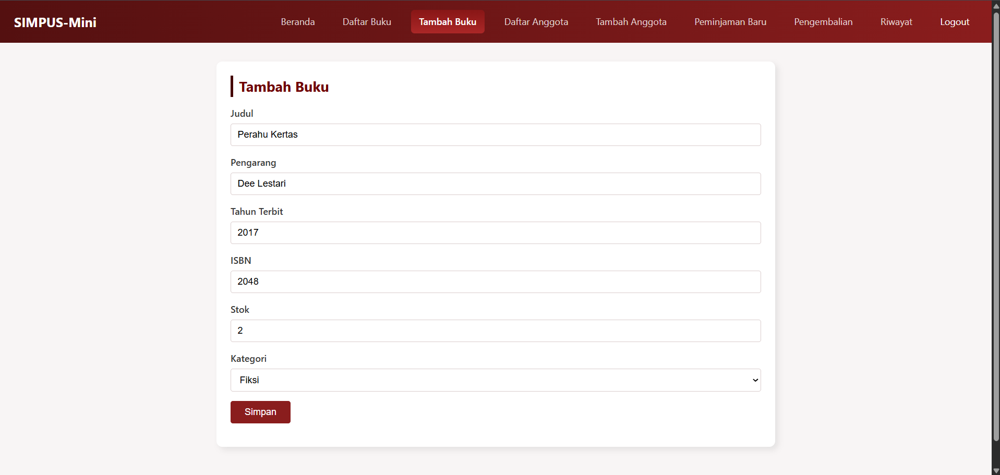
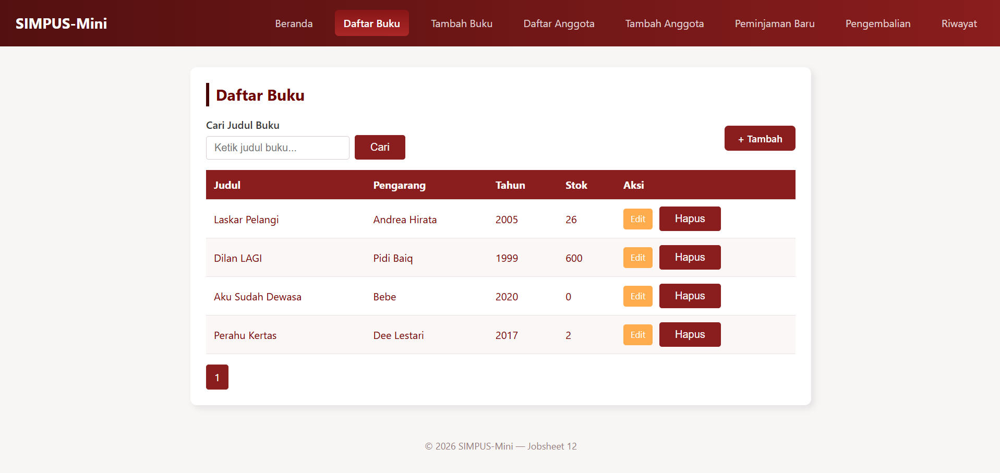
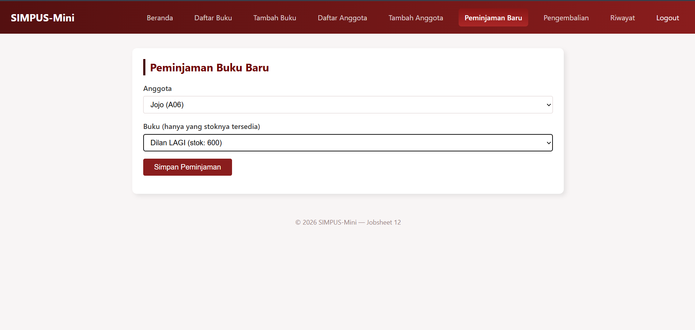
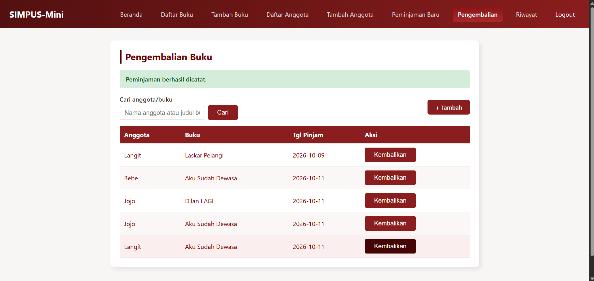
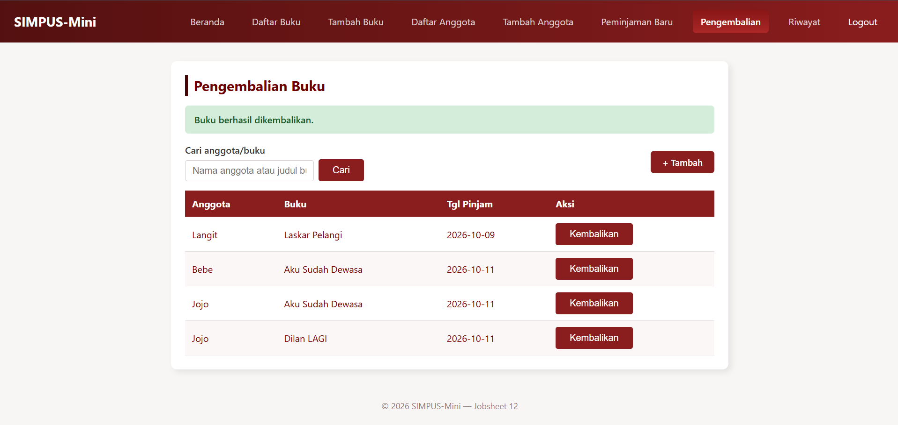
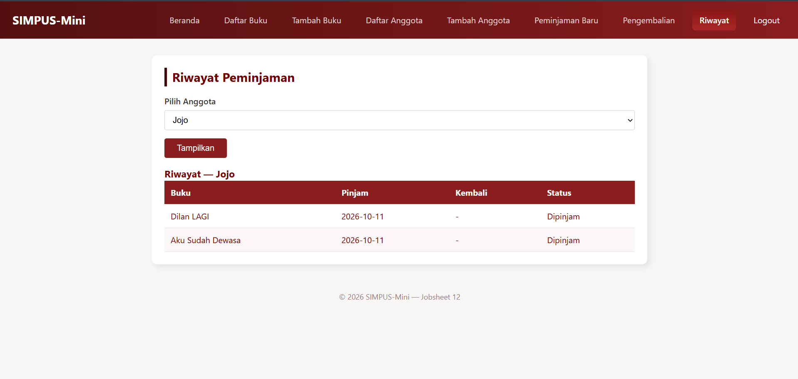

# Manual Pengguna — SIMPUS-Mini

## 1. Registrasi & Login Petugas

1. Buka `http://localhost/simpus-mini/Jobsheett13/auth/register.php`.
2. Isi Nama, Username, Password (minimal 6 karakter), klik **Daftar**. ** 
 
3. Setelah berhasil, akan diarahkan ke halaman Login. Masukkan username & password yang baru dibuat, klik **Masuk**. ** 
 
4. Setelah berhasil login, navbar menampilkan nama petugas dan tombol **Logout**, serta menu tambahan (Tambah Buku, Daftar/Tambah Anggota, Peminjaman) yang tidak terlihat oleh Tamu. 
 

## 2. Mengelola Data Buku

1. Klik menu **Tambah Buku**, isi Judul, Pengarang, Tahun, ISBN, Stok, Kategori, klik **Simpan**. 
 
2. Buku baru langsung tampil di **Daftar Buku**. Gunakan kolom pencarian untuk menyaring berdasarkan judul. 
 
3. Klik **Edit** pada baris buku untuk mengubah data, atau **Hapus** untuk menghapus (akan muncul konfirmasi sebelum data benar-benar dihapus).

## 3. Mengelola Data Anggota

Alurnya sama dengan Buku: menu **Tambah Anggota** → isi form → tampil di **Daftar Anggota** → Edit/Hapus tersedia per baris.

## 4. Meminjamkan Buku

1. Klik menu **Peminjaman Baru**.
2. Pilih **Anggota** dan **Buku** (hanya buku dengan stok tersedia yang muncul di pilihan), klik **Simpan Peminjaman**. 
 
3. Kembali ke **Beranda** — kartu "Sedang Dipinjam" bertambah, dan stok buku terkait di **Daftar Buku** berkurang 1.

## 5. Mengembalikan Buku

1. Klik menu **Pengembalian**.
2. Cari transaksi berdasarkan nama anggota atau judul buku (opsional), lalu klik **Kembalikan** pada baris yang sesuai. 

 
3. Stok buku terkait bertambah kembali 1, dan transaksi hilang dari daftar peminjaman aktif.

## 6. Melihat Riwayat Peminjaman

1. Klik menu **Riwayat**.
2. Pilih nama anggota dari dropdown, klik **Tampilkan**.
3. Tabel menampilkan seluruh riwayat peminjaman anggota tersebut beserta status (Dipinjam/Selesai). 
 

## 7. Logout

Klik **Logout** di navbar kanan atas untuk mengakhiri sesi. Setelah logout, menu-menu yang membutuhkan login (Tambah Buku, Anggota, Peminjaman) akan hilang dari navbar dan halamannya tidak bisa diakses langsung (otomatis diarahkan ke halaman Login).